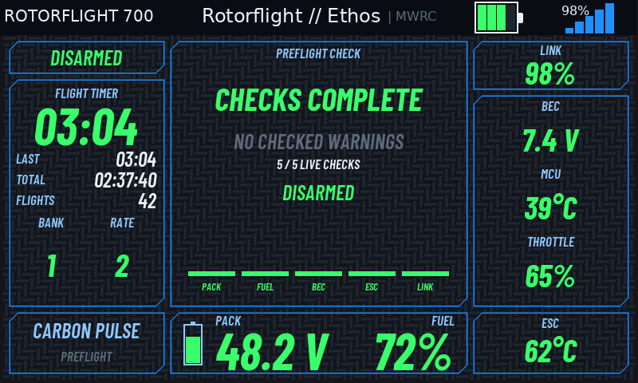

# Carbon Pulse desktop previews

Generated from the implemented theme through the Suite's Lua engine. The glyph
masks and carbon tile are drawn from the theme's files; desktop fonts
approximate the radio's native header. These are not radio screenshots. The 72
render cases cover all phases, both sizes, three appearance modes, and four
data states. See `renders/results.json` for the checks.

## Preflight

## Inflight

## Postflight

Native radio acceptance remains outstanding: mask and bitmap rendering on the
radio, file-loading time and memory use need simulator and physical-radio
testing. This branch contains only Carbon Pulse and its four
selection/configuration registrations.
