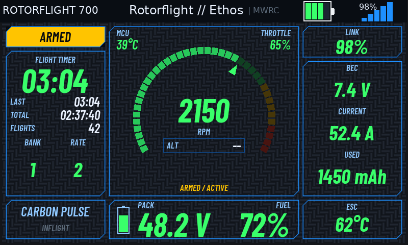
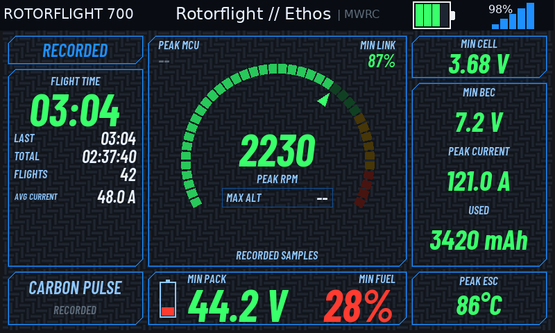

# Carbon Pulse previews

**Desktop preview, not radio capture.** These images execute the theme's actual
Lua layouts through the Suite dashboard engine with simulated telemetry,
800 × 480 geometry and the ETHOS 26 dark palette. The theme's glyph masks and
carbon tile are drawn from its own files; the native header uses desktop
DejaVu Sans font metrics. They do not establish physical-radio appearance or
performance.

| Preflight | Inflight | Postflight |
| --- | --- | --- |
|  |  |  |

[Theme and settings guide](../../dashboard/carbonpulse.md).
